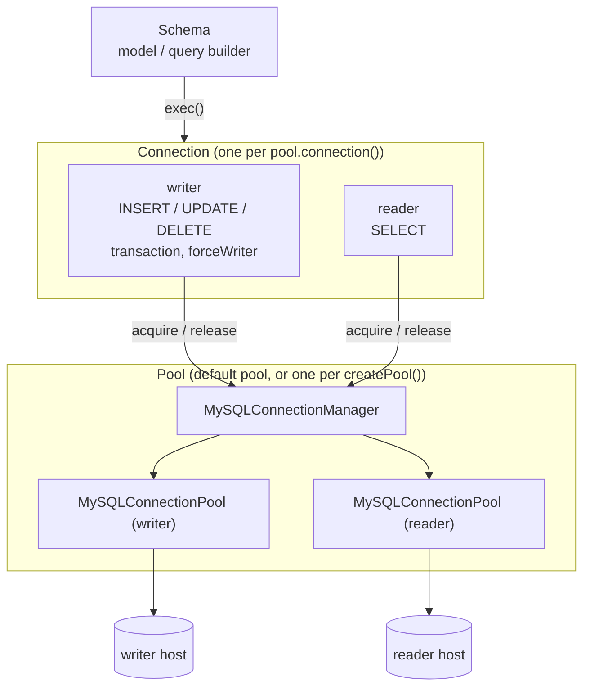

# ReadME

[](https://app.codacy.com/gh/TaxiGo-tw/pool-mysql?utm_source=github.com&utm_medium=referral&utm_content=TaxiGo-tw/pool-mysql&utm_campaign=Badge_Grade_Dashboard)



This is depend on [mysql](https://github.com/mysqljs/mysql)
which made for migrating to features

* multiple connection pool

* connection writer/reader

* async/await

* model.query

* log print

* events

See the test [Examples](https://github.com/TaxiGo-tw/pool-mysql/tree/master/test)

## Installation

```bash
  npm i pool-mysql --save
```

## Usage

<details>
  <summary>Settings</summary>

* pool-mysql loads settings from process.env **when it is first required**, so load your env (e.g. with [dotenv](https://github.com/motdotla/dotenv)) before `require('pool-mysql')`

```bash
SQL_HOST={{writer}}
#reader is optional
SQL_HOST_READER={{reader}}
SQL_USER={{user}}
SQL_PASSWORD={{passwd}}
SQL_DB={{database name}}
```

| Env | Default | Description |
|---|---|---|
| `SQL_HOST` | `127.0.0.1` | writer host |
| `SQL_HOST_READER` | `SQL_HOST` | reader host |
| `SQL_USER` | `root` | writer user |
| `SQL_USER_READER` | `SQL_USER` | reader user |
| `SQL_PASSWORD` | `123` | writer password |
| `SQL_PASSWORD_READER` | `SQL_PASSWORD` | reader password |
| `SQL_PORT` | `3306` | port, shared by writer and reader |
| `SQL_DB` | `test` | database name. `SQL_TABLE` is read as a fallback |
| `SQL_CONNECT_TIMEOUT` | `10000` | connect timeout in ms |
| `CONNECTION_LIMIT` | `30` | max connections, counted separately for writer and reader |
| `SQL_FREE_CONNECTIONS` | `10` | idle connections kept when freeing, see `Auto Free Connections` |
| `QUERY_THRESHOLD_MS` | `500` | a query slower than this emits `longQuery` |
| `QUERY_THRESHOLD_START` | `60000` | ms after process start before `longQuery` is reported |
| `DATA_ENCRYPTION_KEY` | | hex key (32 bytes) for `Encryption` |
| `DATA_ENCRYPTION_IV` | | hex IV (16 bytes) for `Encryption` |

* Connections use charset `utf8mb4` and `multipleStatements: true`. To turn `multipleStatements` off, pass it in `createPool` options — the `SQL_MULTIPLE_STATEMENTS` env cannot disable it.
</details>

<details>
  <summary>Normal Query</summary>

* Require `pool-mysql`

```js
const pool = require('pool-mysql')

pool.query(sql, value, (err, data) => {

})
```
</details>

<details>
  <summary>Multiple Pool</summary>

```js
const options = {
  writer: {
    host: process.env.HOST2,
    database: process.env.DB2
  },
  reader: {
    host: process.env.HOST2,
    database: process.env.DB2
  },
  forceWriter: true
}

const pool2 = pool.createPool({ options, redisClient }) // redisClient is optional
```

* `options.writer` is required, and either `options.reader` or `forceWriter: true`
* Fields not given fall back to the env defaults in `Settings`
* Any key from `Settings` (e.g. `connectionLimit`, `DATA_ENCRYPTION_KEY`) can be overridden per pool

`createPool` returns the same pool only when the whole normalized config (every writer/reader field, `forceWriter`) and the `redisClient` are identical. Pools for the same hosts but a different database, user, password or port are kept separate.
</details>

<details>
  <summary>Create connection</summary>

```js
const connection = pool.connection()

//callback query
connection.query(sql, values, (err,data) => {

})

//support async/await
try {
  const result = await connection.q(sql,value)
} catch(err) {
  console.log(err)
} finally {
  connection.release() // always give it back to the pool
}
```

* A `connection` holds up to one reader and one writer, acquired lazily on first use
* `SELECT` (without `FOR UPDATE`) goes to the reader, everything else goes to the writer
* A connection held for more than 3 seconds emits a `warn` event every 10 seconds (`Stroked` = still querying, `Leaked` = idle and not released)

#### Modifiers

Each one applies to the next query only.

```js
await connection.forceWriter.q(sql, values)       // SELECT on writer
await connection.print.q(sql, values)             // emit `print` event with sql and cost time
await connection.mustUpdateOneRow.q(sql, values)  // throw if affectedRows !== 1
await connection.onErr('custom message').q(sql, values) // string or (err) => string
```

#### Other methods

* `connection.connect('All' | 'Writer' | 'Reader')` acquire connections ahead of time
* `connection.release()` return connections to the pool
* `connection.end()` close the underlying connections instead of reusing them
</details>

<details>
  <summary>Transaction</summary>

* Transactions run on the writer. Use `forceWriter` / `.WRITER()` for a `SELECT` that must see uncommitted rows

```js
const connection = pool.connection()

try {
  await connection.beginTransaction()

  await connection.q('UPDATE user SET name = ? WHERE id = ?', ['foo', 1])
  const rows = await connection.forceWriter.q('SELECT * FROM user WHERE id = ?', [1])

  await connection.commitAsync()
} catch (err) {
  await connection.rollback()
} finally {
  connection.release()
}
```

* `release()` emits a `warn` event if a transaction was started but neither committed nor rolled back
</details>

<details>
  <summary>Connection tag</summary>

* limit max connection amount with same priority

```js
// if 5 or more connections with the same priority are in use, wait for releasing
const connection = pool.connection({ limit: 5 })
```

```js
// connections are counted per priority, default priority is 5
const connection = pool.connection({ priority: 1 })
```

* `limit` defaults to `connectionLimit`
* When the limit is reached the request waits in a queue; it fails with `get connection request timeout` after 10 seconds

</details>

<details>
  <summary>Model setting</summary>

```js
const Schema = require('pool-mysql').Schema

const Posts = class posts extends Schema {
  get columns() {
    return {
      id: Schema.Types.PK,
      user: require('./user') // one to one reference
      //or
      user2: {
        ref: require('./user'), // one to one reference
        column: 'user'
      },

      user3: {
        type: Schema.Types.FK(require('./User.js'), 'id'),
        required: true,
        length: { min: 1, max: 20 },
      },

      user_type: {
        type: Schema.Types.ENUM('A','B','C')
      },

      available_area: {
        type: Schema.Types.Polygon
      },

      created_at: {
        type: Schema.Types.DateTime
      }
    }
}


const User = class user extends Schema {
  get columns() {
    return {
      id: Schema.Types.PK,
      user: [require('./posts')] //one to many reference
    }
}
```

* The table name is the class name (`class posts` → table `posts`)
* `Model.KEYS` returns the real columns as `table.column` strings, for `SELECT(...)`

#### Types

`Schema.Types`: `PK`, `FK(model, column)`, `ENUM(...values)`, `String`, `Number`, `NumberString`, `JSONString`, `Email`, `URL`, `Point`, `Polygon`, `UNIX_TIMESTAMP`, `DateTime`, `Base` (extend it for a custom validator, see `Validation`)

* `Point`, `Polygon`, `JSONString`, `UNIX_TIMESTAMP`, `DateTime` and `FK` convert the value on `SET(object)`
</details>

<details>
  <summary>Query</summary>

```js
await Posts
      .SELECT()         //default to columns()
      .FROM()
      .WHERE({id: 3})    //or you can use .WHERE('id = ?',3)
      .POPULATE('user') //query reference
      .PRINT()            //print sql statement, query time, connection id and works on writer/reader
      .WRITER()         //force query on writer
      .exec()
```

* `exec(connection)` runs on the given connection (e.g. inside a transaction) and leaves it open; `exec()` gets a connection and releases it

#### Builder reference

| Method | Note |
|---|---|
| `SELECT(...columns)` / `FROM(table)` | default to all columns / the model's table |
| `JOIN(on, values)` / `LEFTJOIN(on, values)` | |
| `WHERE(obj)` / `WHERE(sql, values)` / `AND(...)` / `OR(...)` | pass `{ isExec: false }` as third argument of `AND` / `OR` to skip the condition |
| `GROUP_BY(...columns)` / `HAVING(...conditions)` / `ORDER_BY(column, 'ASC' \| 'DESC')` | |
| `LIMIT(n, defaultValue = 20)` / `OFFSET(n, defaultValue = 0)` | |
| `FIRST()` | adds `LIMIT 1`, returns a single object instead of an array |
| `Model.FIND(where)` | shortcut of `SELECT().FROM().WHERE(where)` |
| `Model.FIND_PK(pk)` | find one by the `PK` column |
| `NESTTABLES()` | rows come back as `{ tableA: {...}, tableB: {...} }` |
| `MAP(cb)` / `FILTER(cb)` / `REDUCE(cb, initVal)` | transform results after the query |
| `POPULATE(...fields)` | query references, see `Populate` |
| `EX(seconds, options)` | redis cache, see `cache` |
| `COMBINE()` | see `Combine queries` |
| `DECRYPT(...columns)` / `ENCRYPT(...columns)` | see `Encryption` |
| `WRITER()` / `PRINT()` / `ON_ERR(messageOrCallback)` | |
| `FORMATTED()` | returns `{ query, values, formatted }` without querying |
| `Model.native(connection, sql, values)` | run raw sql; `connection` may be omitted |
| `instance.save()` | `UPDATE` the row by its `PK` with the instance's values |
</details>

<details>
  <summary>Populate</summary>

```js
// nest populate
const result = await Drivers
    .SELECT()
    .FROM()
    .WHERE({ driver_id: 3925 })
    .POPULATE({ trip_id: { driver_loc_FK_multiple: {} }})
    .FIRST()
    .exec()
```
</details>

<details>
  <summary>Nested Query</summary>

```js
const results = Trips.SELECT(Trips.KEYS, Users.KEYS)
    .FROM()
    .LEFTJOIN('user_info ON uid = trips.user_id')
    .WHERE('trip_id = ?', 23890)
    .AND('trip_id > 0')
    .LIMIT()
    .NESTTABLES()
    .MAP(result => {
        const trip = result.trips
        trip.user = result.user_info
        return trip
    })
    .FIRST()
    .exec()

results.should.have.property('trip_id')
results.trip_id.should.equal(23890)
results.should.have.property('user_id')
results.should.have.property('user')
results.user.should.have.property('uid')
assert(results instanceof Trips)
```
</details>

<details>
  <summary>Stream Query</summary>

#### for massive rows query

* Replace exec() with stream()
* Some modifier will not works

* highWaterMark
  * set to 1 : `onValue`.rows will be `object`
  * set to 2 or greater : `onValue`.rows will be `array`
    * rows.length will less or equal to `highWaterMark`

```js
TableA
  .SELECT()
  .FROM()
  .LEFTJOIN('tableB on tableB.id = tableA.id')
  .LIMIT(25)
  .NESTTABLES()
  .MAP(data => {
    const tableA = data.tableA
    return { ...tableA, user: data.tableB }
  })
  .stream({
    connection, //optional
    highWaterMark: 5, //optional, default to 1
    onValue: (rows, done) => {
      assert.equal(rows.length, 5)
      expect(rows[0]).haveOwnProperty('id')
      expect(rows[0]).haveOwnProperty('user')

      done()
    },
    onEnd: (error) => {
      ok()
    }
  })
```

#### async / await

* `done` will be a empty function

```js
.stream({
  connection, //optional
  highWaterMark: 1, // if set to 1, will be object in `onValue`
  onValue: async (row,done) => {
    await doSomething()
  },
  onEnd: async (error) => {
    ok()
  }
})
```

</details>

<details>
  <summary>Insert</summary>

```js
// single
await FOO.INSERT()
  .INTO()
  .SET(obj)
  .exec(connection)

// multiple
await FOO.INSERT()
  .INTO('table (`id`, `some_one_field`)')
  .VALUES(array)
  .exec(connection)

// INSERT IGNORE
await FOO.INSERT(true).INTO().SET(obj).exec()

// ON DUPLICATE KEY UPDATE
await FOO.INSERT()
  .INTO()
  .SET(obj)
  .DUPLICATE({ name: 'foo' }) //or .DUPLICATE('name = ?', 'foo')
  .exec()
```

* `SET(obj, undefined, { passUndefined: true })` drops `undefined` values from `obj` before validating
</details>

<details>
  <summary>Delete</summary>

```js
await FOO.DELETE()
  .FROM()
  .WHERE({ id: 1 })
  .AFFECTED_ROWS(1)
  .exec()
```
</details>

<details>
  <summary>Encryption</summary>

* AES-256-CBC with `DATA_ENCRYPTION_KEY` / `DATA_ENCRYPTION_IV` (both hex)
* The IV is fixed, so the same plaintext always gives the same ciphertext. Lookups such as `WHERE({ phone: Encryption.encrypt(phone) })` rely on this
* `encrypt` / `decrypt` return `''` instead of throwing when the input or key is invalid

```js
const { Encryption } = require('pool-mysql')

const cipher = Encryption.encrypt('0912345678')  // hex string
const plain = Encryption.decrypt(cipher)

// with another key
Encryption.encrypt(text, { key, iv })
```

```js
// encrypt columns when writing
await User.UPDATE()
  .SET({ phone, email }, undefined, { encryption: ['phone', 'email'] })
  .WHERE({ id })
  .exec()

// decrypt columns when reading
await User.SELECT()
  .FROM()
  .WHERE({ id })
  .DECRYPT('phone', 'email')
  .exec()
```

* Only truthy values are encrypted / decrypted; `null` and `''` are left as is
* Encryption applies to `SET(object)`, not to `SET('sql', values)` or `VALUES(array)`
</details>

<details>
  <summary>Updated</summary>

* return value after updated

```js
const results = await Block
        .UPDATE()
        .SET('id = id')
        .WHERE({ blocked: 3925 })
        .UPDATED('id', 'blocker')
        .AFFECTED_ROWS(1) //throw if affectedRows !== 1
        .CHANGED_ROWS(1)  //throw if changedRows !== 1
        .ON_ERR('error message') // custom error message, can be string or callback
        .exec()

for (const result of results) {
    result.should.have.property('id')
    result.should.have.property('blocker')
}
```
</details>

<details>
  <summary>cache</summary>

```js
const redis = require('redis')
const bluebird = require('bluebird')
bluebird.promisifyAll(redis.RedisClient.prototype)
bluebird.promisifyAll(redis.Multi.prototype)

const client = redis.createClient({
  host: ...,
  port: ...,
  db: ...
})

pool.redisClient = client

//...

const connection = pool.connection()

await connection.q('SELECT id FROM user WHERE uid = ?', userID, {
  key: `api:user:id:${userID}`, //optional , default to queryString
  EX: process.env.NODE_ENV == 'production' ? 240 : 12, //default to 0 , it's required if need cache
  shouldRefreshInCache: cached => cached.expired, //optional, return true to query again and overwrite the cache
  redisPrint: true, //optional, log whether the result came from cache
})

await connection.q('SELECT id FROM user WHERE uid = ?', userID, { EX: 60})

User.SELECT().FROM().WHERE('uid = ?',id).EX(60, { forceUpdate: true }).exec()
```

* The client must provide `getAsync` / `setAsync` (e.g. promisified as above)
* Without a `redisClient`, `EX` is ignored and the query runs normally
* Results are stored as JSON. A `null` result is cached too
* Without `key`, the cache key is the sql string prefixed with a namespace derived from the pool's writer host, port, database and user, so pools on different databases sharing one redis never read each other's cache. A custom `key` is used as given
* Identical cached queries running at the same time are combined into one, see `Combine queries`
</details>

<details>
  <summary>custom error message</summary>

```js
await Trips.UPDATE('user_info')
    .SET({ user_id: 31 })
    .WHERE({ uid: 31 })
    .CHANGED_ROWS(1)
    .ON_ERR(errMessage) // string
    .exec()
// or callback
await Trips.UPDATE('user_info')
    .SET({ user_id: 31 })
    .WHERE({ uid: 31 })
    .CHANGED_ROWS(1)
    .ON_ERR(err => {
        return 'error value'
    })
    .exec()
```
</details>

<details>
  <summary>Combine queries</summary>

* mass queries in the same time, combined queries will query once only (scope in instance)

```js
Trips.SELECT().FROM().WHERE({ trip_id:1 }).COMBINE().exec().then().catch()
Trips.SELECT().FROM().WHERE({ trip_id:1 }).COMBINE().exec().then().catch()
Trips.SELECT().FROM().WHERE({ trip_id:1 }).COMBINE().exec().then().catch()
Trips.SELECT().FROM().WHERE({ trip_id:1 }).COMBINE().exec().then().catch()
// the second ... latest query will wait result from first one
```
</details>

<details>
  <summary>Auto Free Connections</summary>

* Every 300 seconds free half of the idle reader&writer connections

* But will keep at least `SQL_FREE_CONNECTIONS` (default 10) idle reader&writer connections
</details>

<details>
  <summary>Events</summary>

* `log` logs `not suggested to subscribe`

* `print` sql and cost time of a query marked with `.print` / `.PRINT()`

* `longQuery` a query slower than `QUERY_THRESHOLD_MS`

* `get` called when connection got from pool

* `did_create` called when connection created

* `release` called when connection released

* `will_query` called before a query, with the formatted sql

* `did_query` called after a query

* `amount` called when connection pool changes amount

* `end` called when connection end

* `request` request a connection but capped on connection limit

* `recycle` a released connection is handed to a waiting request

* `warn` warning

* `err` error

```js
pool.event.on('get', connection => {
    console.log(connection.id)
})
```
</details>

<details>
  <summary>Validation</summary>

* Triggered on UPDATE()..SET(object) and INSERT()...SET(object)

* `values must be object`

[default types](https://github.com/TaxiGo-tw/pool-mysql/blob/master/src/Schema/Types.js)

#### Variables

* type: to limit type

* required: default to false
  * INSERT() checks all required
  * UPDATE() checks SET()

* length: limit something.length

```js

// Custom Validator
class PlateNumber extends Scheme.Types.Base {
  static validate(string) {
    return string.match(/[0-9]+-[A-Z]+/)
  }
}

module.exports = class driver_review_status extends Scheme {

  get columns() {
    return {
      'uid': {
        type: Scheme.Types.PK,
        required: true
      },
      'first_name': {
        type: Scheme.Types.String,
        required: true,
      },
      'last_name': String,
      'car_brand': {
        type: Scheme.Types.JSONString
      },
      'model': {
        type: String
      },
      'phone_number': {
        type: Scheme.Types.String,
        required: true,
        length: 10
      },
      'plate_number': {
        type: PlateNumber,
        length: { min: 6 , max: 9 }
      },
      'email': {
        type: Scheme.Types.Email,
        required: true
      }
    }
  }
}
```
</details>

<details>
  <summary>Mock response</summary>

* [Usage](https://github.com/TaxiGo-tw/pool-mysql/blob/master/test/testConnection.js)

* every query return response from mock() and increase index

* assign mock() to pool will reset index to 0

* ignored when `NODE_ENV` is `production`

```js
pool.mock = (index, sql) => [{ id: 1 }]

await pool.connection().q('SELECT * FROM user') // [{ id: 1 }], no database access

pool.mock = undefined // back to real queries
```
</details>

<details>
  <summary>Dry Run</summary>

* run in a transaction and rollback after execute

```js
await Table.INSERT().INTO().rollback()

// or on your own connection
await Table.INSERT().INTO().rollback(connection)
```
</details>

<details>
  <summary>Logging</summary>

* pool-mysql does not print anything by itself, subscribe to the events you need

```js
pool.event.on('print', toPrint => console.log(toPrint))
pool.event.on('longQuery', toPrint => console.warn(toPrint))
pool.event.on('warn', (identity, message) => console.warn(identity, message))
pool.event.on('err', (identity, error) => console.error(identity, error))
```

* `pool.logger` accepts `'all'`, `'error'` or `'none'`, default to `error`
</details>

### How to update declaration file  
  1. update jsdoc
  2. run `npm run build`
  3. if you need to update .d.ts directly you need add add `exclude` file in tsconfig.json, in case of overwriting

### How to release
  1. bump `version` in package.json in the PR
  2. after merging to master, run `npm test`, then `npm publish` (needs an npm account listed in `npm owner ls pool-mysql`)
  3. tag the commit: `git tag v{version} && git push origin v{version}`
